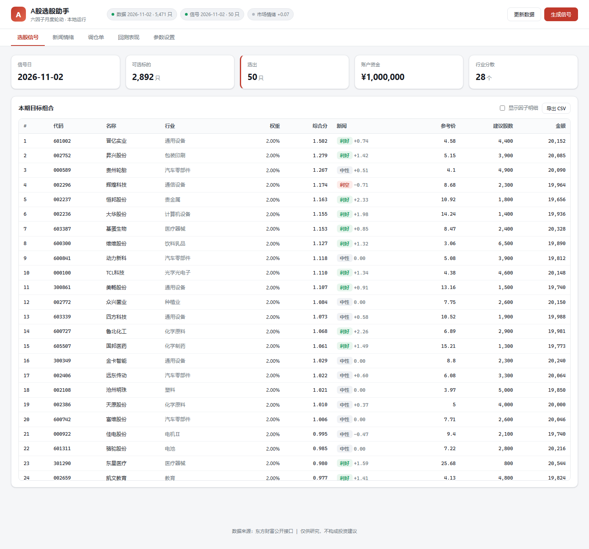
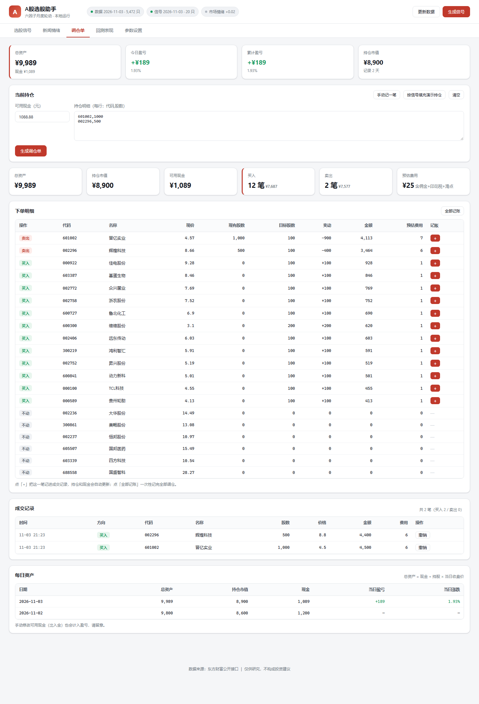
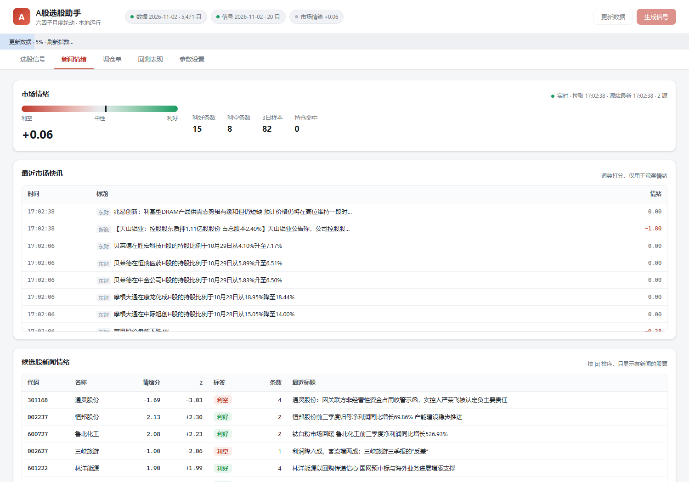
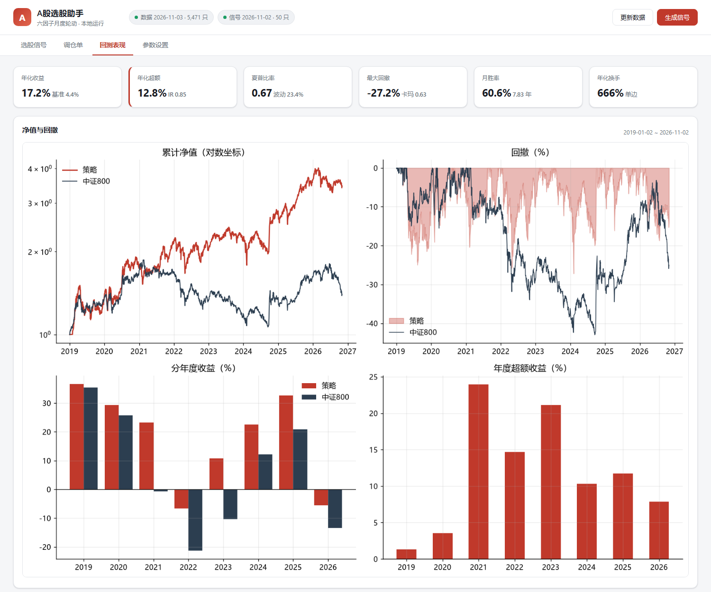

# A股多因子选股策略 · 工程实现

[](https://github.com/Jiongdehuhuan-a/a-share-monthly-picker/actions/workflows/smoke.yml)


一套完整可复现的 A 股中低频量化选股系统：数据抓取 → 因子计算 → 组合构建 → 回测撮合 → 绩效报告，
外加一个可以直接用的**本地选股软件**。

> 🖥 **想直接用界面？** 双击 `启动选股助手.bat`，浏览器打开 http://127.0.0.1:8770
> 详细用法见 [软件使用说明.md](软件使用说明.md)，策略逻辑见 [策略设计文档.md](策略设计文档.md)，
> 参数调优过程见 [output/策略优化.md](output/策略优化.md)

## 界面预览

| 选股信号（含参考买卖价） | 调仓单 |
|---|---|
|  |  |

| 新闻情绪 | 回测表现 |
|---|---|
|  |  |

> 数据区间 2019-01 ~ 2026-11，七因子月频轮动（动量 6-1 + 短期反转 + 盈利质量），
> 回测年化 22.40%、夏普 0.90、最大回撤 -32.7%（详见 `output/回测报告.md`）。

## 两种用法

| 用法 | 入口 | 适合 |
|---|---|---|
| **图形界面** | `启动选股助手.bat` → `http://127.0.0.1:8770` | 日常选股、看调仓单 |
| **命令行 / 自动化** | `python run.py update \| signal \| orders` | 接定时任务、接别的程序 |
| **研究回测** | `python src/backtest.py` | 改参数、验证想法 |

## 目录结构

```
quant-strategy/
├─ run.py                # 统一入口（serve / update / signal / orders / status）
├─ 启动选股助手.bat       # 双击启动界面
├─ 每日更新.bat           # 定时任务用：更新数据 + 算信号
├─ 安装定时任务.bat       # 注册 Windows 计划任务（工作日 17:30）
├─ app/                  # 本地软件（Web 服务 + 界面）
│  ├─ web.py             #   HTTP 服务 + JSON API + 定时调度
│  ├─ datafeed.py        #   增量更新数据（只补最近 15 天；11:30/15:00 后都能拿到当日价）
│  ├─ signals.py         #   生成当期信号（复用回测同一套因子）
│  ├─ pricing.py         #   参考买入/卖出价（波动率 + 跳空分位 + 评分预期涨幅）
│  ├─ news.py            #   新闻抓取 + 利好利空判定 + 情绪打分
│  ├─ orders.py          #   持仓 vs 目标 → 调仓单
│  ├─ config.py / storage.py
│  └─ static/            #   前端页面（含像素风图标）
├─ src/
│  ├─ build_dataset.py   # 抓取全A股日线/估值/指数（东财公开接口，支持断点续传）
│  ├─ build_fundamentals.py # 季度财报（ROE/毛利率），按公告日对齐
│  ├─ consolidate.py     # 原始 parquet 合并为 (日期 × 代码) 宽表面板
│  ├─ backtest.py        # 因子、组合、撮合、绩效全流程
│  ├─ report.py          # 生成图表与 Markdown 报告
│  ├─ price_model.py     # 标定挂单宽度与「综合分 → 预期涨幅」分箱
│  ├─ optimize_grid.py   # 参数/因子网格实验（样本内外验证）
│  ├─ experiments.py     # 参数/因子稳健性检验
│  └─ split_test.py      # 子区间（样本内外）检验
├─ data/                 # ⚠ 不入库，需本地生成（见下）
└─ output/               # 净值、指标、IC、图表、报告（入库，作样例）
```

## 环境

```bash
python -m pip install pandas numpy pyarrow matplotlib
```

回测核心只依赖 `pandas / numpy`；抓数据与画图额外需要 `pyarrow`、`matplotlib`。
中文图表使用 `Microsoft YaHei`，Windows 自带。

## 三步运行

```bash
# 1. 抓数据（首次约 20~30 分钟，之后可断点续传）
python src/build_dataset.py --start 2016-01-01 --workers 8

# 2. 合并面板
python src/consolidate.py

# 3. 回测 + 出报告
python src/backtest.py
python src/report.py --tag N50_noRS

# 可选：稳健性检验（9 组变体，约 3 分钟）
python src/experiments.py
# 可选：子区间检验
python src/split_test.py
```

## 常用参数

`src/backtest.py` 里的 `Config`：

| 参数 | 默认 | 含义 |
|---|---|---|
| `start` / `end` | 2019-01-01 / 2026-12-31 | 回测区间 |
| `top_n` | 50 | 持仓只数 |
| `buffer_ratio` | 1.5 | 老持仓保留缓冲区（降换手） |
| `weights` | 见下 | 因子权重 |
| `max_stock_w` | 0.05 | 单票权重上限 |
| `max_ind_w` | 0.25 | 单行业权重上限 |
| `min_amt20` | 5e7 | 20日均成交额门槛（元） |
| `risk_switch` | False | 是否启用中证800 200日均线择时（默认关闭，见设计文档第6节） |
| `off_exposure` | 0.40 | 择时触发时的股票仓位 |
| `commission/stamp/slippage` | 2.5bp / 5bp / 10bp | 交易成本 |

默认因子权重（2026-11 调优，见 [output/策略优化.md](output/策略优化.md)）：
**七个主因子等权 + 短期反转 0.3 的相对倾斜**。

```python
{"ep": 0.1370, "bp": 0.1370, "momentum": 0.1370,   # 动量口径为 6-1：
 "lowvol": 0.1370, "turnover": 0.1370, "size": 0.1370,
 "ocf_ni": 0.1370,                                 # 盈利质量：经营现金流/净利润
 "reversal": 0.0411}                               # 20 日反转，取负
```

- 动量从 12-1 改成 6-1：原口径在全样本 RankIC 为负（-0.015），是拖累项。
- 新增短期反转（RankIC 0.064，t=3.9，A 股最强单因子），权重 0.3。
- **新增盈利质量 ocf_ni = 经营活动现金流 / 净利润**（应计因子，RankIC +0.019，t=2.6），
  等权。金融股（银行/保险/证券）口径失真，该因子对它们置空，不参与打分。
- 修了 `buffer_ratio` 不生效的 bug（原来调 1.2/1.5/2.0 结果完全一样）。
- 效果：年化 16.66% → **22.40%**，夏普 0.65 → **0.90**，IR 0.84 → **1.20**，
  最大回撤 -27.0% → -32.7%，年换手 6.38 → 6.20；
  样本外（2024-2026）年化 32.1%、夏普 1.35。

想让回撤小一点：把「反转」权重拖回 0（回撤 -31.1%、夏普 0.92），
或者把「质量」权重也拖回 0，退回原六因子版本。

此外还实现了两个**默认关闭**的可选因子（权重滑块里能看到，拖起来即可开启）：

| 因子 | 含义 | 实测 |
|---|---|---|
| `sue` | 标准化预期外盈利（Δ4 EPS / std(过去 8 期 Δ4)） | RankIC +0.0025（t=0.25），组合层面无增量 |
| `fcst_up` | 业绩预告正面占比（滚动 90 天，预增/扭亏等） | RankIC +0.0104（t=1.63），组合层面无显著增益 |

复现：`python src/build_fundamentals.py`（生成 sue）、`python src/build_forecast.py`（生成 fcst_up）。

命令行覆盖：

```bash
python src/backtest.py --top-n 30 --tag N30          # 改持仓数
python src/backtest.py --risk-switch --tag N50_RS    # 打开均线择时
```

## 输出文件

`output/` 下：

- `nav_<tag>.csv` —— 策略与基准日净值
- `metrics_<tag>.json` —— 全部绩效指标 + 分年度 + 最新持仓
- `ic_<tag>.csv` —— 每期综合因子与单因子 RankIC
- `turnover_<tag>.csv` —— 每次调仓的单边换手率
- `fig_performance.png` / `fig_ic.png` —— 图表
- `回测报告.md` —— 自动生成的报告
- `variants.csv` / `稳健性检验.md` —— 稳健性对比

## 数据说明（重要）

仓库**不包含** `data/` 目录：全 A 股 2019 年至今的宽表面板约 **1.3 GB**，
GitHub 不适合放。首次使用需要自己拉一遍（约 20~30 分钟，支持断点续传）：

```bash
python src/build_dataset.py --start 2019-01-01 --workers 8   # 日线/估值/指数
python src/build_fundamentals.py                            # 季度 ROE/毛利率
python src/consolidate.py                                   # 合并成宽表面板
python src/price_model.py                                   # 标定参考买卖价
```

`data/runtime/`（持仓、参数、信号、日志）完全在本地生成，也不会入库。

## 测试

不联网、不需要真实行情也能验证整条链路：`tests/fake_data.py` 会造一套
90 只 × 340 天的合成面板（结构、字段与真实数据完全一致），然后在临时目录里
跑一遍「因子 → 选股 → 撮合 → 绩效」，断言净值、回撤、IC、权重约束都正常。

```bash
pip install -r requirements.txt
python tests/smoke_backtest.py
```

CI（[.github/workflows/smoke.yml](.github/workflows/smoke.yml)）每次 push / PR 都会跑一遍。
测试全程写临时目录，不会覆盖你本地 `data/` 里的真实数据。

## 注意事项

- 数据来自东方财富公开接口，仅用于研究；商用请使用有授权的数据源。
- 股票池只含当前仍在上市的标的，**存在幸存者偏差**，实盘收益通常低于回测。
- 回测假设开盘价可成交（涨停不可买、跌停不可卖），未建模冲击成本的规模效应。
- 新闻情绪部分没有回测（历史新闻拿不到），只作用于实盘。
- 本代码是研究框架，不构成投资建议。

## License

[MIT](LICENSE) · 仅供学习研究
