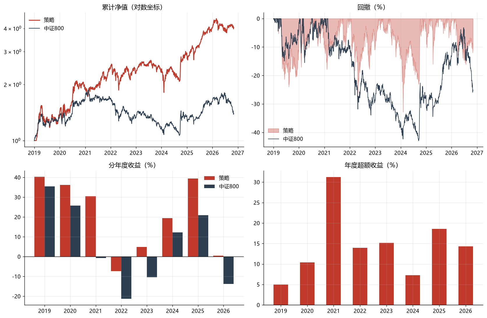
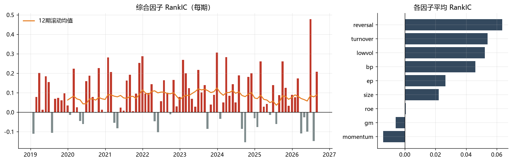

# A股多因子选股策略 · 回测报告

> 回测区间 **2019-01-02 ~ 2026-11-03**（7.84 年） ｜ 基准 **中证800** ｜ 标签 `N50_noRS`

## 一、核心指标

| 指标 | 策略 | 中证800 |
|---|---:|---:|
| 累计收益 | 305.2% | 39.3% |
| 年化收益 | **19.6%** | 4.3% |
| 年化超额 | **15.2%** | — |
| 年化波动 | 23.4% | — |
| 夏普比率 | 0.77 | — |
| 最大回撤 | -32.9% | — |
| 卡玛比率 | 0.60 | — |
| 信息比率 IR | 1.04 | — |
| Beta | 0.94 | 1.00 |
| 月度胜率 | 60.6% | — |
| 月度跑赢基准概率 | 58.5% | — |
| 年化单边换手 | 622% | — |

## 二、分年度表现

| 年度 | 策略 | 中证800 | 超额 |
|---|---:|---:|---:|
| 2019 | 40.4% | 35.4% | 5.0% |
| 2020 | 36.2% | 25.8% | 10.4% |
| 2021 | 30.5% | -0.8% | 31.3% |
| 2022 | -7.4% | -21.3% | 13.9% |
| 2023 | 4.8% | -10.4% | 15.2% |
| 2024 | 19.5% | 12.2% | 7.3% |
| 2025 | 39.4% | 20.9% | 18.5% |
| 2026 | 0.5% | -13.9% | 14.3% |

## 三、因子有效性（RankIC）

- 综合因子平均 RankIC **0.0818**，ICIR **0.68**，IC>0 占比 **73.9%**
- 样本期数 92（月频）

| 因子 | 平均IC | ICIR | 胜率 |
|---|---:|---:|---:|
| ep | 0.0265 | 0.15 | 58% |
| bp | 0.0461 | 0.23 | 61% |
| momentum | -0.0141 | -0.09 | 48% |
| lowvol | 0.0522 | 0.27 | 60% |
| turnover | 0.0540 | 0.27 | 60% |
| size | 0.0222 | 0.13 | 58% |
| reversal | 0.0635 | 0.41 | 60% |
| roe | 0.0006 | 0.01 | 47% |
| gm | -0.0060 | -0.06 | 48% |

## 四、最新一期持仓（2026-11-03，股票仓位 100%）

| 代码 | 名称 | 行业 | 权重 |
|---|---|---|---:|
| 002296 | 辉煌科技 | 通信设备 | 2.0% |
| 601002 | 晋亿实业 | 通用设备 | 2.0% |
| 002758 | 浙农股份 | 综合Ⅱ | 2.0% |
| 000589 | 贵州轮胎 | 汽车零部件 | 2.0% |
| 002111 | 威海广泰 | 航空装备Ⅱ | 2.0% |
| 000922 | 佳电股份 | 电机Ⅱ | 2.0% |
| 603100 | 川仪股份 | 通用设备 | 2.0% |
| 601311 | 骆驼股份 | 电池 | 2.0% |
| 603339 | 四方科技 | 通用设备 | 2.0% |
| 603049 | 中策橡胶 | 汽车零部件 | 2.0% |
| 600739 | 辽宁成大 | 生物制品 | 2.0% |
| 300349 | 金卡智能 | 通用设备 | 2.0% |
| 688550 | 瑞联新材 | 电子化学品Ⅱ | 2.0% |
| 002722 | 物产金轮 | 专用设备 | 2.0% |
| 603387 | 基蛋生物 | 医疗器械 | 2.0% |
| 000045 | 深纺织Ａ | 光学光电子 | 2.0% |
| 000581 | 威孚高科 | 汽车零部件 | 2.0% |
| 002255 | 海陆重工 | 其他电源设备Ⅱ | 2.0% |
| 002546 | 新联电子 | 电网设备 | 2.0% |
| 600694 | 大商股份 | 一般零售 | 2.0% |
| 601728 | 中国电信 | 通信服务 | 2.0% |
| 600742 | 富维股份 | 汽车零部件 | 2.0% |
| 600050 | 中国联通 | 通信服务 | 2.0% |
| 603969 | 银龙股份 | 通用设备 | 2.0% |
| 002533 | 金杯电工 | 电网设备 | 2.0% |
| 600827 | 百联股份 | 一般零售 | 2.0% |
| 002334 | 英威腾 | 自动化设备 | 2.0% |
| 301327 | 华宝新能 | 电池 | 2.0% |
| 603726 | 朗迪集团 | 家电零部件Ⅱ | 2.0% |
| 300861 | 美畅股份 | 通用设备 | 2.0% |

> 共 50 只，仅列前 30。

## 五、说明

- 收益已扣除佣金 2.5bp（双边）、印花税 5bp（卖出）、单边滑点 10bp。
- 信号在月末收盘生成，次一交易日开盘成交；涨停不可买、跌停不可卖。
- 股票池为当前仍在交易的 A 股，**存在幸存者偏差**，实盘表现通常低于回测。
- 回测不含分红再投资的独立建模，价格采用前复权，已隐含分红调整。